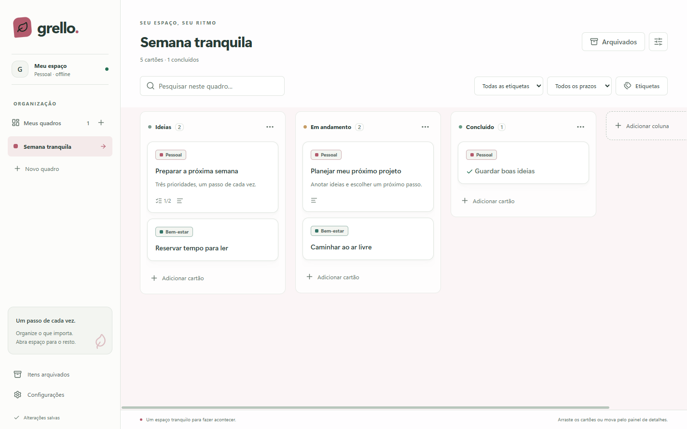
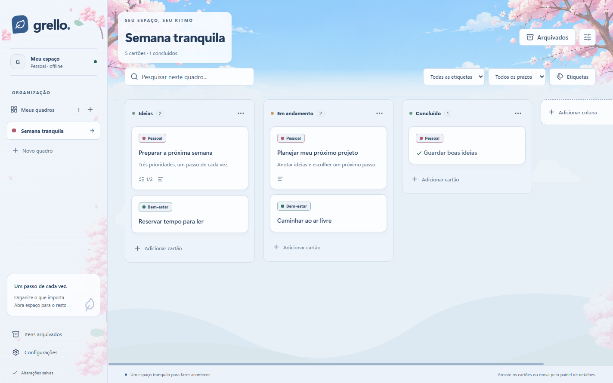
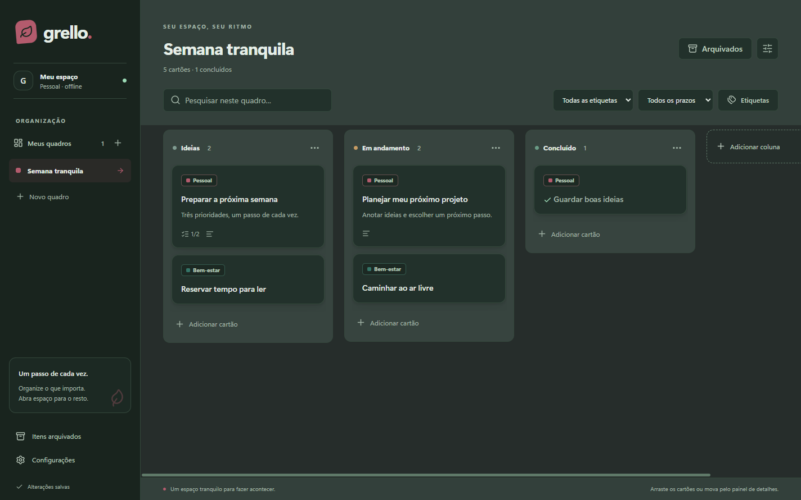
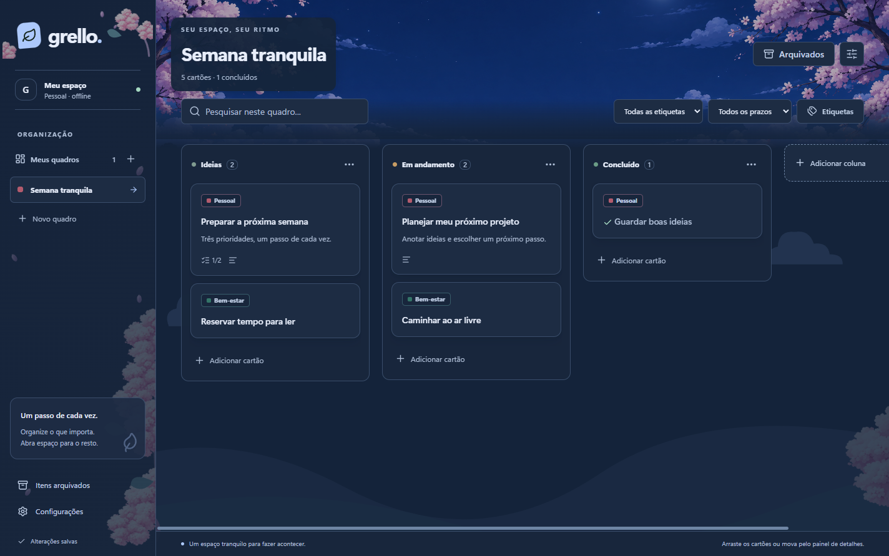

# Grello

Organização pessoal em quadros Kanban, no seu computador. O **Grello 1.1.1** é um aplicativo desktop para Windows x64, em português do Brasil, com dados locais e funcionamento offline.

**[Baixar a versão 1.1.1](https://github.com/g1zin/grello/releases/tag/v1.1.1)** · [Licença MIT](LICENSE) · [Créditos e licenças](CREDITS.md)

## O que você pode fazer

- Criar, renomear, ordenar e arquivar quadros.
- Organizar colunas e cartões; arrastar cartões ou movê-los pelo painel de detalhes.
- Editar descrição, etiquetas coloridas, prazo e checklist; duplicar, concluir, arquivar e restaurar cartões.
- Pesquisar por título/descrição e filtrar por etiqueta ou situação do prazo.
- Escolher modos claro/escuro e personalizar a aparência.
- Exportar/importar seus dados e criar backups locais.

As alterações são salvas automaticamente em SQLite. Não há login, conta, assinatura, sincronização, colaboração ou serviço de IA dentro do aplicativo.

## Aparência da versão aprovada

As capturas abaixo usam **dados fictícios gerados pelos testes**, sem dados pessoais.

| Original | Céu e Cerejeiras |
| --- | --- |
|  |  |
|  |  |

Em **Configurações → Aparência**, escolha Original ou Céu e Cerejeiras pelas miniaturas. O modo Claro/Escuro é independente do estilo; Sistema acompanha a preferência do computador.

Céu e Cerejeiras combina paisagens originais de dia/noite e decoração suave. A intensidade pode ir a zero sem apagar textos ou controles. Somente pequenas pétalas junto à marca se movem; há opção de desativá-las, respeito a reduzir movimentos e pausa ao ocultar/minimizar.

As cores personalizadas dos quadros ficam preservadas. Céu e Cerejeiras usa sua paleta nas superfícies; ao voltar ao Original, suas cores voltam a aparecer. Os marcadores laterais continuam identificando os quadros pela cor escolhida.

## Baixar, instalar e abrir

Na [Release Grello 1.1.1](https://github.com/g1zin/grello/releases/tag/v1.1.1), abra a seção **Assets** e escolha:

| Arquivo | Como usar |
| --- | --- |
| [Grello-Instalador-1.1.1.exe](https://github.com/g1zin/grello/releases/download/v1.1.1/Grello-Instalador-1.1.1.exe) | Execute o assistente. A instalação configura atalhos na área de trabalho e no menu Iniciar. |
| [Grello-Portatil-1.1.1.exe](https://github.com/g1zin/grello/releases/download/v1.1.1/Grello-Portatil-1.1.1.exe) | Abra diretamente, sem instalar. |
| [SHA256SUMS.txt](https://github.com/g1zin/grello/releases/download/v1.1.1/SHA256SUMS.txt) | Hashes SHA-256 dos dois executáveis. |

Não é necessário instalar Node.js nem abrir terminal/servidor para usar os executáveis. A primeira abertura do portátil pode levar algum tempo para extrair seus arquivos.

**Instalador e portátil usam a mesma pasta de dados do usuário.** “Portátil” descreve o executável: os quadros não ficam ao lado dele nem são transportados automaticamente em um pendrive.

Os executáveis **não possuem assinatura digital comercial**. O Windows pode mostrar editor desconhecido. Baixe os arquivos desta Release e, se desejar, confira o hash no PowerShell:

```powershell
Get-FileHash .\Grello-Instalador-1.1.1.exe -Algorithm SHA256
Get-FileHash .\Grello-Portatil-1.1.1.exe -Algorithm SHA256
```

Compare com o arquivo SHA256SUMS.txt. Os pacotes são para Windows x64; outros sistemas não têm builds validados.

## Dados, exportação e backups

O armazenamento fica separado do código e da instalação:

```text
%APPDATA%\Grello\grello.sqlite
%APPDATA%\Grello\backups\
```

Use **Configurações → Abrir pasta de dados / Abrir pasta de backups**. Atualizar ou reinstalar preserva essa pasta; o instalador está configurado para não apagar os dados na desinstalação. O aplicativo não criptografa o banco ou os backups.

- **Exportar dados** gera JSON com todos os quadros, cartões, etiquetas, checklists e preferências.
- **Importar → Mesclar** adiciona cópias com novos identificadores e preserva seus dados/preferências atuais. Repetir a importação cria novas cópias.
- **Importar → Substituir** troca todos os dados/preferências, pede confirmação e cria um backup antes da alteração.
- **Criar backup agora** produz uma cópia SQLite consistente.
- Há backup automático antes de substituir dados e antes de migrar um banco existente. Se o backup falhar, a operação é abortada.

O JSON atual tem versão 2; exportações da versão 1 continuam importáveis. Arquivos inválidos, referências quebradas e versões incompatíveis são recusados antes de alterar dados. O limite de importação é 25 MB.

Guarde cópias importantes em outro local: backups na mesma máquina não protegem contra perda do disco. Não há backup em nuvem ou sincronização automática.

### Restaurar um backup

Para JSON, use **Importar → Substituir com backup**.

Para um arquivo SQLite:

1. Feche o Grello.
2. Copie a pasta de dados inteira para um local seguro.
3. Guarde o banco atual e eventuais arquivos `grello.sqlite-wal` / `grello.sqlite-shm` juntos em outra pasta.
4. Copie o backup escolhido para a pasta de dados e renomeie a cópia para `grello.sqlite`.
5. Reabra o Grello. Mantenha o backup original.

Não misture arquivos WAL de bancos diferentes. Com o aplicativo aberto, use exportação/backup pelo aplicativo; não copie apenas o arquivo principal. Um banco atualizado não deve ser aberto por uma versão mais antiga incompatível.

## Usar no dia a dia

Crie um quadro, adicione colunas e cartões. Clique no cartão para editar os detalhes. Arraste para reorganizar ou use **Mover cartão** no painel. **Concluir edição** aguarda o salvamento.

Excluir uma coluna com cartões exige outra coluna do mesmo quadro como destino, incluindo cartões arquivados. Exclusões permanentes pedem confirmação. Quadros podem ser arquivados e restaurados.

A edição automática espera uma pequena pausa na digitação; fechar o painel ou a janela aguarda as gravações. Encerramento forçado pelo sistema pode perder o texto que ainda não foi enviado. Dados de demonstração são opcionais e ficam em um quadro separado.

## Executar o código

Ferramentas verificadas: Windows x64 build 26200, Node.js 24.21.0 e npm 11.19.0. Use Node.js 24 e as dependências exatas do lockfile.

```powershell
git clone https://github.com/g1zin/grello.git
cd grello
npm.cmd ci
npm.cmd run dev
```

O comando compila e abre a janela Electron. Após editar, feche a janela e execute novamente. Downloads iniciais das ferramentas precisam de internet; o aplicativo instalado funciona offline.

Usamos `npm.cmd` para evitar o bloqueio de `npm.ps1` em alguns ambientes PowerShell, sem alterar a política de execução.

## Testar e gerar pacotes

```powershell
npm.cmd run format:check
npm.cmd test
npm.cmd run build
npm.cmd run test:vertical
npm.cmd run package:dir
npm.cmd run test:e2e
$env:GRELLO_PACKAGED='1'
npm.cmd run test:appearance
npm.cmd run package
node tests/portable-smoke.mjs
npm.cmd run audit:publication
```

- `test`: persistência, importação, backup e migrações em bancos temporários.
- `test:e2e`: fluxo básico na janela real do executável de `release/win-unpacked`.
- `test:appearance`: estilos, modos, contraste, foco, tamanhos de janela, animações e interações. Sem GRELLO_PACKAGED=1, usa o build de desenvolvimento.
- `package:dir`: gera o aplicativo em pasta.
- `package`: gera instalador NSIS e portátil Windows x64 em `release`.
- `licenses`: atualiza os avisos a partir das dependências instaladas; executado antes de empacotar.
- `audit:publication`: verifica arquivos rastreados e blobs do histórico em busca de padrões de credenciais, bancos e caminhos privados.

Os testes usam pastas temporárias isoladas. Nunca use seus dados reais como alvo de testes. A seleção de arquivos nos diálogos nativos é simulada nos E2Es; as operações de arquivos/banco são reais.

Os instaladores ficam fora do histórico Git e são distribuídos pela Release. O GitHub oferece o código-fonte da tag em ZIP/tar.gz. Não há atualização automática embutida.

## Estrutura e customizações

`src/renderer` contém interface, temas e tokens; `src/domain`, as regras; `src/data`, SQLite e migrações; `src/main`, janela/IPC/integrações; `src/shared`, modelos e validação. `tests` contém verificações de dados e interface.

Leia [AGENTS.md](AGENTS.md) antes de modificar dados ou migrações. O banco usa esquema 3, UUIDs estáveis, transações e backup antes de migração. Não edite migrações já publicadas nem recrie um banco existente para corrigir um problema.

## Verificações e limitações

Os resultados desta publicação estão em [docs/PUBLICACAO-1.1.1.md](docs/PUBLICACAO-1.1.1.md). Há registros anteriores em [VALIDACAO-1.1.1.md](VALIDACAO-1.1.1.md).

O assistente de instalação, os atalhos e a seleção manual pelos diálogos de arquivos precisam de conferência manual no computador de destino. Não há validação completa com leitores de tela, outras escalas de DPI, encerramento forçado ou volumes extremos de cartões.

O Grello foi pensado para organização pessoal, sem colaboração e sem sincronização. As alterações salvam o conjunto de entidades em uma transação; volumes muito grandes podem exigir evolução no acesso ao banco.

## Autoria, assistência de IA e licença

**Guilherme Alves** é responsável pela direção do projeto, escolhas visuais e testes manuais de aprovação. O desenvolvimento do código, a organização e parte da automação das verificações tiveram assistência de **IA/Codex**. As paisagens e os conjuntos de flores foram gerados com **imagegen**; a procedência e os prompts estão registrados no projeto.

A licença **MIT** que já existia foi preservada. Ela permite reutilização sob suas condições, incluindo a manutenção dos avisos de licença/copyright. Dependências e componentes de terceiros mantêm suas próprias licenças.

Consulte [LICENSE](LICENSE), [CREDITS.md](CREDITS.md), [THIRD_PARTY_NOTICES.md](THIRD_PARTY_NOTICES.md) e [LICENSES](LICENSES).
